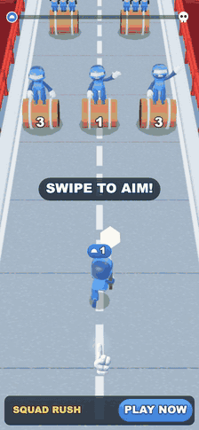
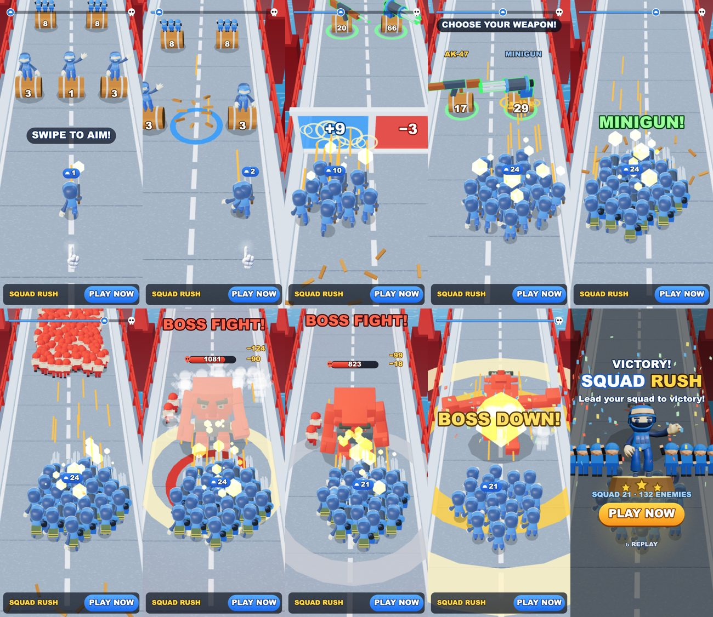

# Squad Rush — 3D playable ad, собранный ИИ-пайплайном

**▶ Играть в браузере / с телефона:** https://bankaino.github.io/squad-rush-playable/
(A/B-варианты: [minigun_easy](https://bankaino.github.io/squad-rush-playable/minigun_easy.html) · [big_crowd](https://bankaino.github.io/squad-rush-playable/big_crowd.html) · [near_miss](https://bankaino.github.io/squad-rush-playable/near_miss.html))

<p align="center"><br><sub>демо-прогон бота, 25 с · <a href="docs/media/gameplay.mp4">MP4 в лучшем качестве</a></sub></p>

Портретная 3D playable-реклама в жанре «армия бежит по мосту»: свайпаешь влево-вправо, отряд стреляет сам. Бочки с цифрами отдают рекрутов, ворота растут от выстрелов (**красные «−3» можно прострелять в плюс**), на развилке нужно выбрать **одно** оружие — AK или миниган, дальше красная орда и босс-великан. Сделана **по мотивам рекламы Top War: Battle Game** (чужая игра и её скриншоты — в репозиторий не включены): жанр и ключевые приёмы те же, а название, интерфейс, код, баланс и весь визуальный стиль — свои. Весь арт **процедурный**, кроме двух бесплатных CC0-моделей (солдат и босс, Quaternius) и одной растровой картинки — руки-подсказки (7 KB). Весь путь от референса до билдов под рекламные сети пройден с **Claude Code** (план, код, симуляция) на three.js.



## Что внутри за ~23 секунды

| время (демо-прогон) | бит | что видит игрок |
|---|---|---|
| 0–0.7 с | хук | один солдат уже стреляет, три бочки «3·1·3» с махающими рекрутами, рука и «SWIPE TO AIM!». В рекламном режиме до первого касания (≤ 2 с) **«призрачный палец» сам ведёт отряд**, чтобы глагол был виден без текста; он никогда не считается вводом игрока |
| 0.7 с | первая награда | бочка с единицей разлетается, рекрут прыгает с неё в строй дугой; к 5-й секунде отряд — 10 бойцов (ряд бочек «8·8» даёт по 3 рекрута) |
| 4.9–7.3 с | ворота | в синие «+2» стреляют, число растёт на единицу за 10 попаданий и цвет стекла плывёт красный → синий; пробегаешь — «+14», к 8-й секунде 24 бойца |
| 9.8 с | **выбор оружия** | «CHOOSE YOUR WEAPON!»: дешёвый AK (20 HP) или дорогой миниган (66 HP); сломал одну бочку — вторая пропадает. Миниган: вспышка, FOV-удар, ящик с патронами на спинах, «MINIGUN!» |
| 10.7–15.5 с | **вау: орда** | 96 красных бойцов в симуляции, каждый нарисован тремя фигурами (≈290 на экране), бегут стеной через весь мост; убитые поднимаются белыми призраками. Демо-бот расстреливает всех, не потеряв ни одного бойца |
| 16.3 с | босс | гигант падает сверху, растёт и приземляется кольцом и тряской; его HP = 500 + 37 × размер вашего отряда (скрытая «резиновая лента», бой всегда ~4–7 с) |
| 16.9–20.6 с | бой с боссом | замах и удар (убивает 3 бойца), «STAGGER!» на 75/50/25 % HP, над боссом полоска HP и вылетающий урон; демо теряет 3 бойца |
| 20.6 с | финал | «BOSS DOWN!»: вспышка, кольца, конфетти, замедление ×0.35 |
| 22.6 с+ | эндкард | заголовок по результату, 3D-подиум с героем и ликующими выжившими, звёзды, PLAY NOW (весь экран — CTA) |

Принципы из практики плейаблов: одно касание; награда ≤ 8 с после первого действия (здесь 0.7 с); **кнопка стора видна всё время**; на каждое действие — отклик (вспышки, кольца, тряска, FOV-удар, частицы, звук); проигрыш — тоже эндкард, без жёсткого фейла («THE HORDE WON!» / «BOSS HAD N% LEFT!»); рука возвращается после 2.5 с простоя.

**Что, если зритель ничего не трогает?** Первые 2 с играет призрачный палец, потом отряд просто бежит, стреляет сам и забирает то, что попадает под прямой огонь; на 12-й секунде без касаний показывается эндкард «CAN YOU BEAT THE BOSS?». Отпустил палец после игры — эндкард через 10 с; жёсткий потолок — 28 с от первого касания.

### Что взято из референса и что сделано по-своему

| в рекламе-референсе | здесь |
|---|---|
| бочки с числами, из которых выходят рекруты | то же; число на передней стенке бочки, на попадании «подпрыгивает», на бочках стоят махающие бойцы |
| красные ворота «−2», в них стреляют, число растёт | то же: значение растёт от попаданий (шаг 10), стекло плавно из красного в синее, рябь от каждой пули, всплеск при проходе |
| AK и миниган лежат на бочках, зелёная обводка | выбор **исключающий**: ломается одна бочка, вторая пропадает; оружие вращается с зелёной обводкой (инвертированный корпус) |
| убитые красные — белые «призраки» | то же, плюс кольцо-пуф; призраки вырастают и тают за 0.7 с |
| босс-гигант с полоской HP и толпой красных | CC0-великан, вход с падением, удар по земле с ударной волной, стаггер на порогах HP, HP растёт вместе с отрядом |
| мост над морем, красные башни | процедурный мост: рельсы, 6 башен, тросы с подвесами, море с анимированной рябью (плоскость и текстура) |
| цифры и иконки интерфейса | свой HUD: счётчик отряда со шлемом, полоска «отряд → череп», урон над боссом, баннер выбора оружия |

## Билды под рекламные сети — одной командой

```bash
python tools/build_playable.py --variant all
```

Каждый билд — **один HTML-файл** без внешних запросов: three.js (tree-shaken), код, модели и адаптер сети.

| сеть | размер | лимит | CTA / жизненный цикл |
|---|---|---|---|
| AppLovin | 1.02 MB | 5 MB | MRAID `mraid.open` |
| Unity Ads | 1.02 MB | 5 MB | MRAID |
| ironSource | 1.02 MB | 5 MB | DAPI `openStoreUrl` |
| Mintegral | 1.02 MB | 5 MB | `install()`, `gameReady()`, `gameEnd()` |
| Google Ads | 0.33 MB (zip) | 5 MB | `ExitApi.exit()` |
| Meta | 1.02 MB | 2 MB | `FbPlayableAd.onCTAClick()` |

Звук выключается, когда реклама не видна (MRAID `viewableChange` / DAPI `audioVolumeChange` / скрытая страница) и стартует только после первого касания (автоплей браузеров). Полный отчёт: [docs/build-report.md](docs/build-report.md). **Ссылки на сторы в `tools/build.json` — заглушки** (`com.example.squadrush`, `id0000000000`): перед отправкой в сети подставьте свои и пересоберите.

## Бюджет и оптимизация

| что | значение | как |
|---|---|---|
| вес | **1.02 MB** | three.js 696 KB (tree-shaken), код 55 KB, солдат 118 KB, босс 67 KB, рука 7 KB |
| draw calls | **17–45** | бочки, оружие, чиби, трассеры, вспышки, кольца — пулы инстансов (`KIT.Pool`), мост и дорога — один слитый меш; тени — «пятна» одним вызовом, настоящая тень только у босса |
| треугольники | **25k на старте, ≤ 197k** на кадре с ордой | 24 CC0-бойца по 3.6k + ≈300 процедурных чиби орды и миньоны; далёкие враги за верхним краем кадра не рисуются |
| модели | 2 × CC0, **185 KB** | один скинованный меш и один draw на бойца (голова вшита в скелет, оружие и наплечники убраны), перекраска палитры в canvas |
| звук | **0 байт** | процедурный WebAudio (`live/audio.js`), компрессор, приглушение выстрелов после наград |
| FPS | **61** в мобильном вьюпорте 390×844 | замер на десктопном железе в headless-браузере (на телефоне не мерился) |

Экран заполняется на любом телефоне: ширина вида 1080, высота следует соотношению сторон устройства (16:9 … 19.5:9), HUD раскладывается от высоты (проверено пробой на 390×693, 390×844 и 390×845).

## Сложность и A/B-гипотезы

Сложность подбиралась не на глаз, а ботами: `tools/casual.mjs` гоняет 300 «обычных» игроков (реакция 0.3–0.8 с, шум прицела, 25 % неверных ворот, 30 % пропускают второй ряд, 12 % «стоят на месте») и 300 «хороших» (`--profile good`, без ошибок). После первой проверки на живом человеке («слишком легко, проиграешь, только если ничего не взять») выяснилось, что хорошие боты выигрывали в 100 % случаев и всегда получали миниган: строй был шире расстояния между бочками, и ломались обе. Теперь выбор оружия исключающий, ворота растут медленнее, босс бьёт сильнее.

Вариант = JSON с гипотезой и переопределением параметров (`variants/*.json`), билдится той же командой (сборка применяет `K`-переопределения, затем пересобирает уровень). Цифры — модель, не реальные данные:

| вариант | параметры | гипотеза | обычные: победа / проигрыш | хорошие: победа |
|---|---|---|---|---|
| `default` | — | база: выбор оружия решает, миниган — «страховка» | 37% / 59% | 80% (миниган 100%, AK 67%) |
| `minigun_easy` | `MINI_HP 40` | дешёвый миниган: wow раньше почти у всех. *Раннее вау против выбора* | 40% / 56% | 84% |
| `big_crowd` | `GATE_STEP 7` | ворота растут быстрее, отряд 20 вместо 17: толпа вместо оружия, заметно легче (это бывший лёгкий дефолт). *Лёгкая игра против сложной* | 58% / 42% | 100% |
| `near_miss` | `FAKE_FAIL`, `RAGE_*` | босс всегда остаётся с ≈7 % HP: «BOSS HAD 7% LEFT!». *Кликают ли проигравшие* | 0% / 100% | 0% |

Вариант `X2` (вторая пара ворот ×2 перед ордой) в серию не вошёл: ворота попадают в бой с ордой, победа падает до 40 %.

## Как проверяется качество

- **Детерминированная симуляция** (`live/sim.js`, 120 Гц, `SIM.K` — единственный источник чисел): всё — состояние и события; демо-прогон проверяется headless (`SIM.demoCheck`): первая награда ≤ 1.5 с, ≥ 5 рекрутов к 5-й секунде, ворота ≥ +6, миниган в окне 8–11.5 с, орда расстреляна ≥ 85 % без обмена, босс в 15.5–17.5 с, бой 3.5–5.7 с, потери ≤ 8, победа ≤ 24.5 с; пассивный зритель доходит до эндкарда.
- **Модель игрока** (`tools/casual.mjs`, ~2 с на 300 прогонов): победа / проигрыш / таймаут, доля минигана, размер отряда на арене, длина боя, разбивка по оружию и по группам игроков.
- **Smoke-тест** (`tools/smoke_test.mjs`): открывает собранный HTML в мобильном вьюпорте с заглушкой MRAID, свайпает, тапает CTA, отпускает палец и ждёт эндкард; проверяет — нет ошибок, нет внешних запросов, счёт растёт, CTA вызывает `mraid.open`, FPS ≥ 50, эндкард с CTA и replay появился сам.
- **Профайл сцены** (`probe.mjs`): draw calls, треугольники, размер героя в % экрана и **наложения/выходы HUD** на 12 QA-состояниях (старт, рекрут, ворота, выбор оружия, миниган, орда, вход босса, бой, смерть босса, три эндкарда).

## ИИ-пайплайн

1. **Разбор референса** (4 кадра рекламы Top War: Battle Game) → вопросы заказчику и решения: полный цикл с эндкардом, свой бренд Squad Rush, гибрид «CC0-модели + процедурные чиби», исход зависит от игрока.
2. **План** (`study/SPEC.md`) написал Claude Opus 5.5: правила и числа, стиль, HUD, звук, модель игрока, фазы с критериями готовности. **Реализовал** по нему Claude Sonnet 5.5 (фазы 1–4: симуляция → мир и модели → HUD, звук, сочность → варианты и выдача).
3. **Правила** подбирались перебором через headless-ботов, пока тайминги битов не стали устойчивыми; тот же цикл потом поднял сложность по отзыву живого игрока.
4. **Мир и вид**: процедурная геометрия на three.js, стиль в `art/style_bible.txt`; CC0-солдат подготовлен скриптом `art/prep_soldier.mjs`; все кадры смотрятся только в контрольных точках, остальное — числа.
5. **Решения заказчика по ходу**: босс заменён на CC0-модель «Giant» вместо перекрашенного солдата; сложность поднята после живой игры.
6. **Проверка**: боты, smoke, probe, QA HUD → правки → варианты → билды.

Весь пайплайн — от референса до билдов — пройден **собственными скиллами для Claude Code**.

## Запуск локально

```bash
python -m http.server 8961      # из корня репозитория
# http://localhost:8961/live/index.html?ad=1  — живая версия (рекламный режим, с призрачным пальцем; &dev — draws и fps)
# http://localhost:8961/live/index.html       — авто-демо (attract), любое касание — играть
python tools/build_playable.py --variant all --pages docs   # билды в dist/ + демо для GitHub Pages
PLAYWRIGHT=<путь к playwright> node tools/smoke_test.mjs dist/default/applovin.html   # нужен Playwright
node tools/casual.mjs --n 300                  # «обычные» игроки; --profile good — без ошибок; --variant near_miss
```

Клавиши в живой версии: P — пауза, `[` `]` — скорость, `.` — шаг, Esc — демо, R — рестарт, ← → / A D — управление. `tools/record_media.mjs` пишет демо-прогон кадр за кадром (для `docs/media/`), `art/viewer.html` + `art/_shot.mjs` — просмотр модели.

## Границы и открытое

- Звук написан по коду и **не прослушан** живым человеком; FPS мерился на десктопном железе, на телефоне — нет.
- Нет иконки приложения на эндкарде и «стоп-кадра» на смерти босса; ссылки на сторы — заглушки.
- Лицензия на код не выбрана; CC0-модели и three.js (MIT) — см. [licenses/](licenses/).

## Структура

- `live/` — игра: `sim.js` (правила), `scene.js` (3D-мир), `hud.js`, `audio.js`, `kit.js` (общие примитивы), `models/` (2 GLB), `vendor/three.min.js`
- `tools/` — сборка под сети, smoke-тест, модель игрока, запись медиа
- `variants/` — A/B-варианты
- `study/` — спецификация (`SPEC.md`; числа в ней устарели), актуальное состояние (`PLAN.md`)
- `docs/` — демо для GitHub Pages и медиа; `licenses/` — лицензии; `art/` — стиль и подготовка модели
